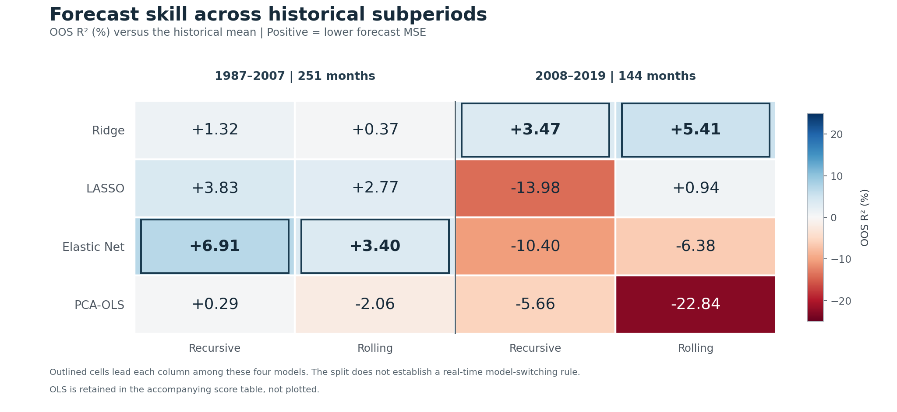
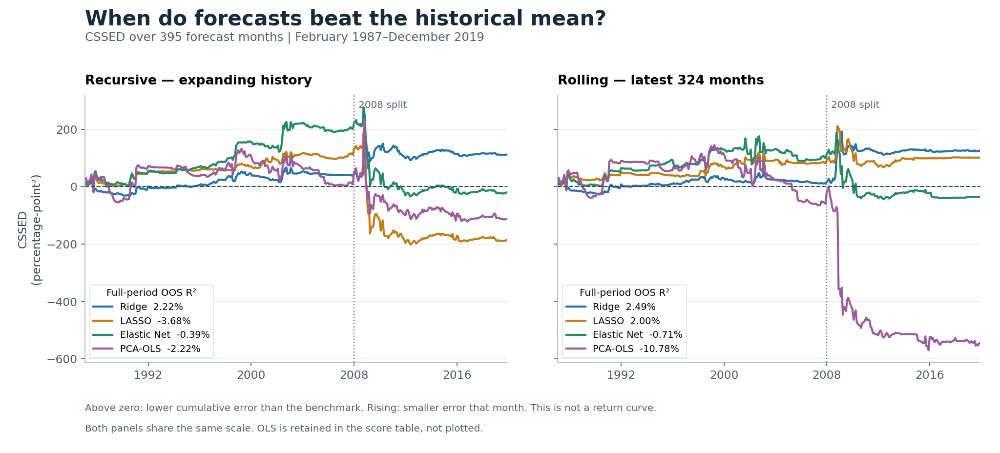

# Forecasting the S&P 500 Equity Premium with High-Dimensional Predictors

A study of how regularization, dimension reduction and training-window choice affect next-month equity-premium forecasts before and after 2008.

[`analysis.ipynb`](analysis.ipynb) contains the complete analysis, from data preparation through monthly model estimation and evaluation. It is saved with outputs and can be inspected without the private input data.

## Setup

- Monthly data from January 1960–December 2019: 118 macroeconomic/financial predictors and 14 binary technical signals.
- Target: next-month log-price return plus the monthly dividend-yield component, less the monthly risk-free rate; see [data definitions](data/README.md).
- Five models: OLS, Ridge, LASSO, Elastic Net and PCA-OLS. PCA reduces all 132 standardized predictors to 14 components.
- Recursive and rolling forecasts begin with 324 training observations and cover 395 OOS months, February 1987–December 2019. Each window's historical mean is the benchmark.

Ridge, LASSO and Elastic Net standardize the 118 macro/financial predictors and leave binary signals unchanged. Scaling and PCA are fitted on each outer training window.

## Findings

Elastic Net led before 2008, reaching 6.91% OOS R² with recursive training; Ridge led afterward, reaching 5.41% with rolling training. OLS performed poorly across both periods.

| Period | Window | OLS | Ridge | LASSO | Elastic Net | PCA-OLS |
|---|---|---:|---:|---:|---:|---:|
| 1987–2007 | Recursive | -92.87 | 1.32 | 3.83 | 6.91 | 0.29 |
| 1987–2007 | Rolling | -116.86 | 0.37 | 2.77 | 3.40 | -2.06 |
| 2008–2019 | Recursive | -172.03 | 3.47 | -13.98 | -10.40 | -5.66 |
| 2008–2019 | Rolling | -450.85 | 5.41 | 0.94 | -6.38 | -22.84 |

Table values are OOS R² (%): `100 × (1 − model MSFE / benchmark MSFE)`. CSSED accumulates benchmark squared error minus model squared error; positive values favor the model. The [full score table](results/forecast_scores.csv) includes all five models. OLS is omitted from both figures for readability.

## Run

With Python 3.12, install `python -m pip install -r requirements.txt`, supply `data/monthly_data.csv` following [the input specification](data/README.md), then run all notebook cells. This refits every monthly forecast and updates the aggregate results and figures. Raw observations and individual predictions are not included in this repository.

Technical note: ordinary CV and outer-window preprocessing are retained; LASSO and Elastic Net may emit convergence warnings. The 2008 split describes historical forecasting performance.
